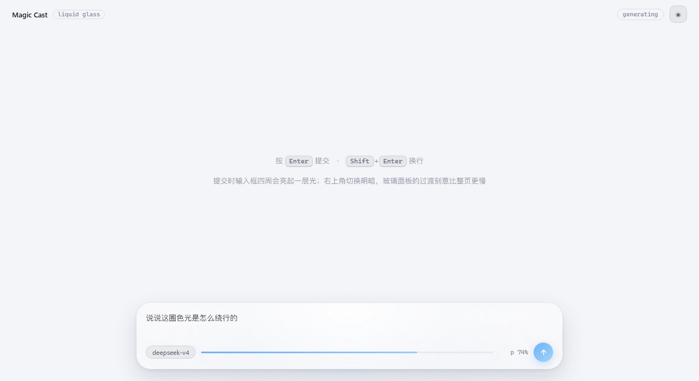
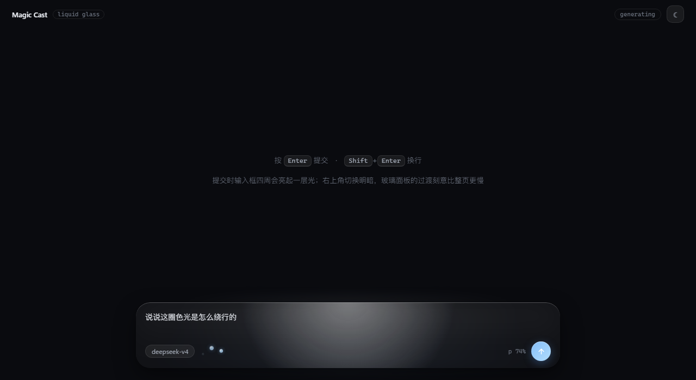

# dsh-liquid-glass-composer

> **把 DeepSeek Harness 的输入框变成一片液态玻璃。**

顶部镜面高光、内缘白线、边缘缓慢绕行的镶边光；模型思考时玻璃里往上冒泡；
深浅主题切换带 1.7 秒的从容过渡。




## 安装

```bash
dsh plugin --profile <你的 profile> add dsh-liquid-glass-composer
```

从 GitHub 装：

```bash
dsh plugin --profile <你的 profile> add github:Siloet-phy/dsh-liquid-glass-composer
```

> 桌面版 DSH 的包管理需要**先完全退出 DSH** 再执行；装完重启生效。
> profile 名一般是 `desktop`（桌面版）或 `web`（`dsh web` 起的服务）。

## 它做了什么

| 元素 | 说明 |
|---|---|
| **磨砂玻璃** | 白雾 + 重度模糊，是"玻璃感"的来源（不是简单叠一层半透明） |
| **顶部镜面高光** | 玻璃最容易辨认的那道柔光 |
| **内缘白线** | 上缘一道发丝白线 —— Apple 液态玻璃最标志性的一笔 |
| **边缘镶边光** | 1.5px 的渐变亮边沿边框**缓慢绕行**（150 秒一圈），几乎察觉不到在动，但停下来就会觉得少了什么 |
| **外扩散泛光** | 光从玻璃边缘微微溢到外面一圈 |
| **三点吐泡泡** | **只在模型思考时出现**：三颗泡错开 1/3 周期，一个破灭、一个新生 |
| **主题过渡** | 浅 ↔ 深切换时，玻璃比整页更慢地插值（1.7s vs 0.9s） |

## 两个我坚持的设计决定

1. **玻璃里不放颜色。**
   真正的液态玻璃几乎是"无色"的——透白玻璃 + 染白的雾 + 白边色散。
   颜色只允许出现在**边缘的高光**上。任何"玻璃内部有一团彩色在流动"的做法，
   看着都会像彩色塑料。（我做出过六版彩色玻璃，全被否了。）
2. **不改 DSH 原生输入框的任何样式与结构。**
   本插件只往 slot 里**加一层**，靠 CSS 变量贴合尺寸。
   所以原生主题、字号、布局更新都不会和它打架；卸载后原样恢复。

## 兼容性

- **DSH**：`0.2.0-rc.2` 及以上（依赖 `conversation.input.overlay` slot 与
  `ctx.theme` 的 `theme/change` 事件）。
- **平台**：Web 客户端（桌面版内置浏览器 / `dsh web`）。纯 CLI 会话不受影响。
- **浏览器**：Chromium 系（Electron）。`mask-composite` 与 `backdrop-filter` 需要现代内核。
- **无障碍**：遵循 `prefers-reduced-motion`——开启后所有动画停止，只保留静态玻璃与状态色。

## 开发

```bash
node selftest.mjs
```

用替身把客户端 bundle 完整跑一遍：语法、模块面（`name`/`inject`/`apply`）、
`apply()` 在有无服务时的行为、slot 注册目标、样式挂载、`theme/change` 订阅、
组件渲染——共 19 项断言。**改完 client.js 先跑它**，
因为客户端 bundle 一旦在最顶层抛错会牵连 Web 端模块系统。

## 技术笔记

- **主题**：直接消费 DSH 的 `--dsw-*` token 与 `body[data-ds-dark-theme]`，
  **不自己管理主题状态**；过渡窗口通过监听 `ctx.theme` 的 `theme/change` 事件实现。
- **挂点**：`conversation.input.overlay`（list，session 作用域）；
  "模型是否在思考"来自标准 props 的 `useSession((s) => s.running)`。
- **踩过的坑**（都写进注释了）：
  - `mask-composite` 必须 `-webkit-` 前缀 + 标准属性**双写**，否则镶边会糊成实心块。
  - 玻璃里的彩色无论多淡都会显土；低饱和色块压在深底上还会变泥浆色。
  - 循环动画必须让元素在关键帧里**自己收束**——曾做成"无限上浮"，到顶被裁掉，看不出破灭。
  - 给会动的元素做 `scaleY` 调幅度时**必须显式写 `transform-origin`**，否则元素会"消失"。
- **参考**：
  [wxperia/liquid-glass-vue](https://github.com/wxperia/liquid-glass-vue) 与
  [rdev/liquid-glass-react](https://github.com/rdev/liquid-glass-react)（折射位移图的算法来源），
  以及 Apple 的液态玻璃设计语言。

## 截图说明

`docs/light.png` 与 `docs/dark.png` 是设计稿（单文件 HTML 演示）在浏览器里的实拍；
插件的实现与设计稿逐像素对齐（同一套 CSS）。设计稿与全部探索过程在同一作者的
`magic-cast` 工作目录里，未随包发布。

## 卸载

```bash
dsh plugin --profile <你的 profile> remove dsh-liquid-glass-composer
```

卸载后输入框恢复原样，不会残留样式（样式表随插件生命周期移除）。

## 许可证

MIT
